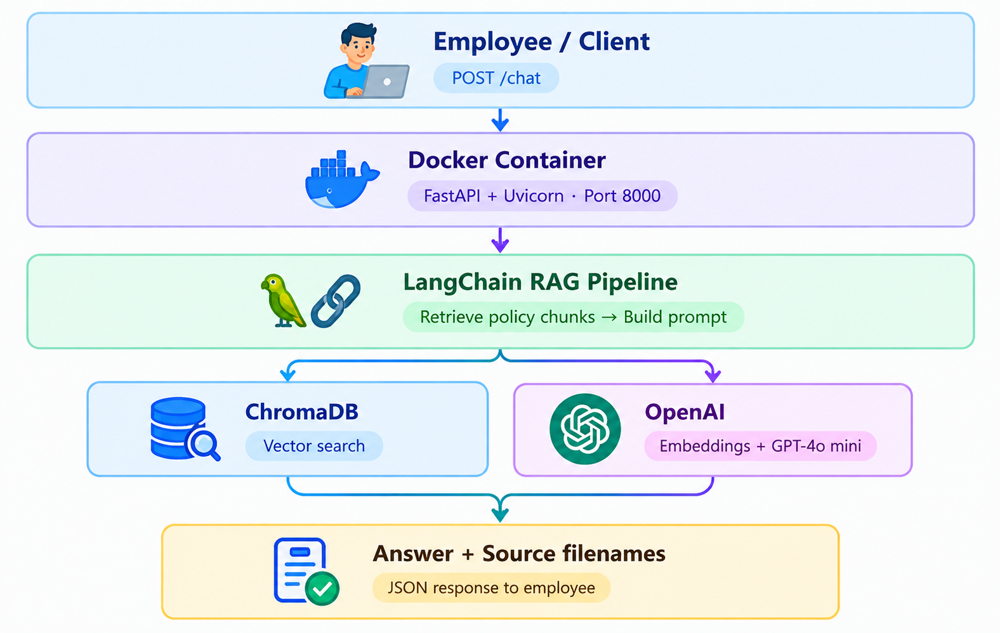

# HR Assistance AI Chatbot — Comprehensive Step-by-Step Guide

This guide provides end-to-end instructions for building, running, testing, and publishing the HR Assistance AI Chatbot Docker container to **Docker Hub**, as well as pulling and deploying it on any server or workstation.

<div align="center">
  
</div>

---

## Table of Contents
1. [Prerequisites](#1-prerequisites)
2. [Project Setup & Local Run](#2-project-setup--local-run)
3. [Building the Docker Image](#3-building-the-docker-image)
4. [Running with Docker Compose](#4-running-with-docker-compose)
5. [Step-by-Step Guide: Push to Docker Hub](#5-step-by-step-guide-push-to-docker-hub)
6. [Pulling & Running from Docker Hub on Any Machine](#6-pulling--running-from-docker-hub-on-any-machine)
7. [API Verification & Testing Workflow](#7-api-verification--testing-workflow)
8. [Troubleshooting & FAQ](#8-troubleshooting--faq)

---

## 1. Prerequisites

Before starting, ensure you have the following installed on your machine:

- **Docker Desktop** (or Docker Engine + Docker Compose v2)
  - Verify: `docker --version` and `docker compose version`
- **Docker Hub Account**: Sign up at [hub.docker.com](https://hub.docker.com) if you do not already have one.
- **OpenAI API Key**: Create an API key at [platform.openai.com](https://platform.openai.com) with access to:
  - Model: `gpt-4o-mini`
  - Embedding Model: `text-embedding-3-small`
- **Git** (optional, for version control)
- **Python 3.12+** (optional, only if running natively without Docker)

---

## 2. Project Setup & Local Run

### Step 2.1: Clone or Navigate to the Directory
```bash
cd hr-assistant-poc
```

### Step 2.2: Configure Environment Variables
Create your local `.env` file from the provided `.env.example`:

**Linux/macOS:**
```bash
cp .env.example .env
```

**Windows (PowerShell):**
```powershell
Copy-Item .env.example .env
```

Edit `.env` and fill in your OpenAI credentials:
```env
OPENAI_API_KEY=sk-proj-yourActualOpenAiKeyHere
OPENAI_MODEL=gpt-4o-mini
OPENAI_EMBEDDING_MODEL=text-embedding-3-small
CHROMA_COLLECTION_NAME=hr_documents
CHUNK_SIZE=800
CHUNK_OVERLAP=150
TOP_K_RESULTS=4
```

> **Security Note:** Never commit your `.env` file to Git or include it inside the Docker image. It is already included in `.gitignore` and `.dockerignore`.

---

## 3. Building the Docker Image

### Step 3.1: Understanding the Build
The application uses `python:3.12-slim` for a minimal attack surface and small image size. The build process copies `requirements.txt` first to cache dependency layers, then copies the application source code and predefined HR policy documents.

### Step 3.2: Build Command
Run the build command from the root of `hr-assistant-poc`:

```bash
docker build -t hr-assistant-poc:latest .
```

To build with a specific semantic version tag:
```bash
docker build -t hr-assistant-poc:1.0.0 .
```

### Step 3.3: Verify the Built Image
Check that your image is listed:
```bash
docker images | grep hr-assistant-poc
```
*(On Windows PowerShell: `docker images | Select-String "hr-assistant-poc"`)*

---

## 4. Running with Docker Compose

Docker Compose automatically handles container networking, `.env` injection, and binds the host directory `./data/chroma_db` to `/app/data/chroma_db` inside the container for vector database persistence.

### Step 4.1: Start the Container
```bash
docker compose up -d
```
The `-d` flag runs the container in detached mode (in the background).

### Step 4.2: Check Container Status
```bash
docker compose ps
```
You should see `hr-assistant-app` running and listening on `0.0.0.0:8000->8000/tcp`.

### Step 4.3: View Live Logs
```bash
docker compose logs -f hr-assistant
```
You should see:
```text
INFO: Initializing HR Assistance AI Chatbot service...
INFO: OpenAI configuration: model=gpt-4o-mini, embedding=text-embedding-3-small
INFO: Uvicorn running on http://0.0.0.0:8000
```
Press `Ctrl+C` to exit log streaming (the container keeps running).

### Step 4.4: Stop the Container
```bash
docker compose down
```

---

## 5. Step-by-Step Guide: Push to Docker Hub

Follow these steps to publish your image to Docker Hub so colleagues or deployment servers can pull and run it.

### Step 5.1: Create a Repository on Docker Hub (Web UI)
1. Log in to [Docker Hub](https://hub.docker.com).
2. Click **Create Repository**.
3. Name your repository (e.g., `hr-assistant-poc`).
4. Set visibility to **Public** (or **Private** based on preference).
5. Click **Create**.

### Step 5.2: Authenticate via Docker CLI
In your terminal, log in to your Docker Hub account:

```bash
docker login
```
Enter your Docker Hub **Username** and **Password** (or Personal Access Token).

> **Tip:** If you have 2-Factor Authentication (2FA) enabled, generate a Personal Access Token (PAT) under **Account Settings > Security > Access Tokens** on Docker Hub and use it as your password.

### Step 5.3: Tag Your Image for Docker Hub
Docker requires image tags to follow the naming convention:
`<dockerhub-username>/<repository-name>:<tag>`

Replace `<your-dockerhub-username>` with your actual Docker Hub username:

```bash
# Tag for version 1.0.0
docker tag hr-assistant-poc:latest <your-dockerhub-username>/hr-assistant-poc:1.0.0

# Tag for latest
docker tag hr-assistant-poc:latest <your-dockerhub-username>/hr-assistant-poc:latest
```

*Example:*
```bash
docker tag hr-assistant-poc:latest alexdevops/hr-assistant-poc:1.0.0
docker tag hr-assistant-poc:latest alexdevops/hr-assistant-poc:latest
```

### Step 5.4: Push the Image to Docker Hub
Push both the versioned tag and the `latest` tag:

```bash
docker push <your-dockerhub-username>/hr-assistant-poc:1.0.0
docker push <your-dockerhub-username>/hr-assistant-poc:latest
```

Docker will push all layers to Docker Hub. Once finished, visit your repository on Docker Hub to confirm the image tags are visible.

### Optional: Multi-Architecture Build (AMD64 & ARM64/Apple Silicon)
If building across different chip architectures:
```bash
docker buildx build --platform linux/amd64,linux/arm64 \
  -t <your-dockerhub-username>/hr-assistant-poc:latest \
  --push .
```

---

## 6. Pulling & Running from Docker Hub on Any Machine

Once published, anyone (or any remote VM) can run the application with a single command without needing the source code.

### Option A: Using `docker run` directly

1. Create a minimal folder with a `.env` file containing your `OPENAI_API_KEY`:
   ```bash
   mkdir hr-bot && cd hr-bot
   echo "OPENAI_API_KEY=sk-your-openai-key" > .env
   mkdir -p data/chroma_db
   ```

2. Pull and run the container:

   **Linux / macOS:**
   ```bash
   docker run -d \
     --name hr-assistant-app \
     -p 8000:8000 \
     --env-file .env \
     -v "$(pwd)/data/chroma_db:/app/data/chroma_db" \
     --restart unless-stopped \
     <your-dockerhub-username>/hr-assistant-poc:latest
   ```

   **Windows (PowerShell):**
   ```powershell
   docker run -d `
     --name hr-assistant-app `
     -p 8000:8000 `
     --env-file .env `
     -v "${PWD}/data/chroma_db:/app/data/chroma_db" `
     --restart unless-stopped `
     <your-dockerhub-username>/hr-assistant-poc:latest
   ```

### Option B: Using Docker Compose with Docker Hub Image
Create a `docker-compose.yml` on any host:

```yaml
services:
  hr-assistant:
    image: <your-dockerhub-username>/hr-assistant-poc:latest
    container_name: hr-assistant-app
    ports:
      - "8000:8000"
    env_file:
      - .env
    volumes:
      - ./data/chroma_db:/app/data/chroma_db
    restart: unless-stopped
```

Then run:
```bash
docker compose pull
docker compose up -d
```

---

## 7. API Verification & Testing Workflow

### Test 1: Service Health Check
```bash
curl -X GET "http://localhost:8000/health"
```
**Expected Response:**
```json
{
  "status": "healthy",
  "openai_configured": true,
  "model": "gpt-4o-mini",
  "embedding_model": "text-embedding-3-small",
  "vector_store": "ready",
  "indexed_chunks": 12
}
```

### Test 2: Document Indexing (`POST /index`)
```bash
curl -X POST "http://localhost:8000/index" \
     -H "Content-Type: application/json" \
     -d '{}'
```
*Note: If documents are already indexed, this endpoint returns `"status": "skipped"` to prevent incurring extra OpenAI embedding costs. Pass `{"force": true}` to force a re-index.*

### Test 3: Ask In-Policy HR Question
```bash
curl -X POST "http://localhost:8000/chat" \
     -H "Content-Type: application/json" \
     -d '{"question": "How many days of annual leave do I get?"}'
```
**Expected Response:**
```json
{
  "question": "How many days of annual leave do I get?",
  "answer": "Full-time employees receive 20 paid annual leave days per calendar year, accrued at approximately 1.67 days per full month worked.",
  "sources": [
    "leave_policy.txt"
  ]
}
```

### Test 4: Ask Out-of-Scope Question (Hallucination Guard)
```bash
curl -X POST "http://localhost:8000/chat" \
     -H "Content-Type: application/json" \
     -d '{"question": "What is the company stock trading policy?"}'
```
**Expected Response:**
```json
{
  "question": "What is the company stock trading policy?",
  "answer": "I'm sorry, but the available HR policy documents do not contain sufficient information to answer this question. Please reach out to the HR department at hr@company.local for further assistance.",
  "sources": []
}
```

### Test 5: Verify Persistence Across Container Restarts
1. Confirm chunks are indexed:
   ```bash
   curl -s "http://localhost:8000/health"
   ```
2. Restart container:
   ```bash
   docker compose restart hr-assistant
   ```
3. Check health status again:
   ```bash
   curl -s "http://localhost:8000/health"
   ```
   *The `indexed_chunks` count remains intact and no re-indexing is required!*

---

## 8. Troubleshooting & FAQ

### Issue: `OpenAI API key is missing or not configured`
- **Cause:** `.env` file does not exist, or `OPENAI_API_KEY` is set to the default placeholder.
- **Solution:** Edit `.env` and set `OPENAI_API_KEY=sk-...`. If using Docker Compose, restart with `docker compose down && docker compose up -d`.

### Issue: `docker: command not found` on Windows
- **Cause:** Docker Desktop is not installed or not added to your system PATH.
- **Solution:** Ensure Docker Desktop is installed and running with WSL 2 backend enabled.

### Issue: `denied: requested access to the resource is denied` during `docker push`
- **Cause:** You are either not logged in, or the image tag does not match your Docker Hub username.
- **Solution:**
  1. Run `docker login`.
  2. Ensure image tag format is `<your-dockerhub-username>/<repo>:<tag>`.

### Issue: Port 8000 already in use
- **Cause:** Another process or container is using port 8000.
- **Solution:** Change the host port in `docker-compose.yml`:
  ```yaml
  ports:
    - "8080:8000"
  ```
  Then access the API at `http://localhost:8080`.
